# Custom Model Tutorial
This is a walkthrough of the general process I use to import a model into the game. We will be taking an Elite from the Halo franchise and dropping them into the world of Age of Mythology. In order to make this somewhat interesting, we will be creating a unit that uses a Plasma Rifle and throws Plasma Grenades, who then berserks and swaps to an Energy Sword at low health. At the end, there is also a brief overview for getting started with custom PopcornFX modding, including an example project.

This repository doesn't actually contain any assets. For the full mod, including all assets and the PopcornFX project, download from: https://drive.google.com/file/d/1jOJBKOuXgtUrVHXsyyRHnJs8ZLt1N2qm/view?usp=drive_link

What this tutorial will cover:
* Very basic exporting of models from blender
* Importing models into the game
* .fbximport files
* Model materials
* Animations
* Very briefly custom particles using PopcornFX

<br>

This tutorial will not cover:
* 3D modelling
* texture authoring
* animating

Assumed knowledge:
This walkthrough assumes basic knowledge on how to create a custom unit with a custom anim.xml, as well as how simdata works with animfiles.

## Disclaimer
This is just a process I have stumbled upon through much trial and error. This may not be the best way, most efficient way, or even most correct way to go about all this, but it works well enough for me so I figured I may as well share it. That said, the vast majority of everything contained in this guide can be found in the documentation the devs provide along with the game. The documentation is EXTREMELY thorough so I highly recommend consulting it if you get stuck or don't understand what something is. If the documentation is too scary, there is also the entire games worth of examples to see it in practice.

## Exporting the model
To start, this is the model in blender with materials already setup.

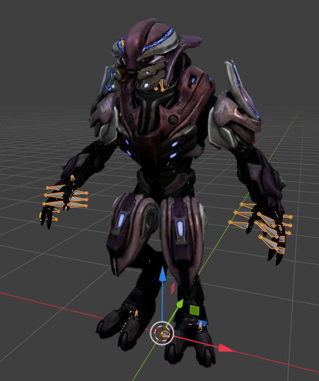

In order to convert the model as painlessly as possible there are a few things to consider doing before export:
1. Set the material names before exporting. Game assets usually use MatA, MatB, etc, but you can call them whatever you want. Verify that they are what you expect before export, as blender can rename materials.
2. Ensure the mesh(es) are correctly parented to the armature
3. Ensure the mesh(es) are **triangulated**. Either the game will immediately close or conversion will fail if there are any quads or ngons in the mesh. There is an export setting for this in the fbx exporter.
4. Ensure that your armature has the root bone of the actual skeleton as the first entry in the list under the armature. The converter only converts the first bone and it's children and ignores the rest, so if your skeleton isnt parented off of the first bone it won't get converted.

Regarding scale and orientation: there is no globally "correct" value that will work for everything - it is entirely model dependent. Both of these can be changed and hot-reloaded in the fbximport without restarting the game, so finding the correct values for a model is very simple and painless.

That being said, it is probably best to scale the mesh down to the game's scale before exporting, which can help avoid issues like launch points being misaligned. To figure out the scale values to do this, you can just load up a model from the game files (the ExampleArcher mod example has an fbx model that is good for this).

To export, we simply select the mesh + armature and export it as an fbx file. Note that for this specific example, there is a single mesh with multiple materials. Its always good to check the exported model as well in case Blender renamed a material. Note the armature parent, single mesh, and material names.
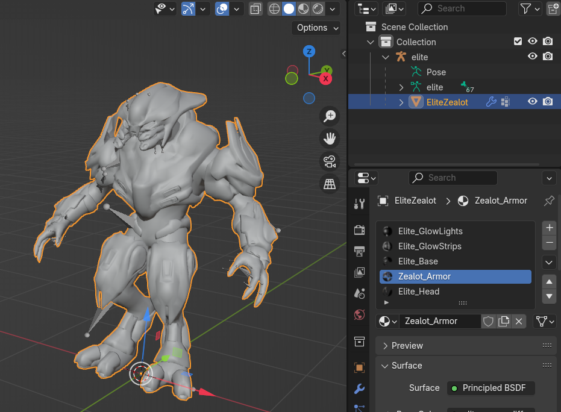

## Importing the model
First, make sure to check out the `ModelSystemModding_Documentation.pdf` document, as it covers the entire process.

The general process for importing a model is:
1. Create fbx file
2. Create fbximport file
3. Use in-game menu to convert model
4. Use in-game menu to generate manifest file
5. Repeat 1-4 for any other models 
6. Restart game

We already have the fbx file, so now we need to make the fbximport file.

### Initial FBXImport
FBX Import files contain metadata that defines how a model or animation is converted to TMM/TMA. Full reference can be found in section 2 of `TMModel_Documentation.pdf`, and the full list of .fbximport files used for game assets can be found in `game\art\ArtImportFilesForModders.bar`. There are two ways to author an fbximport file:

#### 1. Use the Model Convert menu to generate a template:
One is to use the button in the model converter tool in the editor to create a blank template fbximport file and then build off of that. Scroll down to the *"FBX files with no matching FBXImport section"*, click the *"Actions"* button, and then click the relevant *"Generate FBXImport"* option.

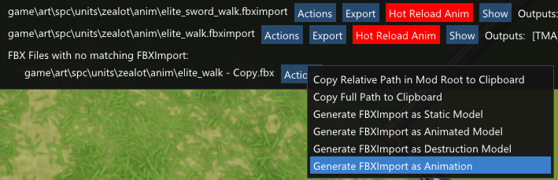

`"Static Model"` is for non-animated, non-skinned static meshes such as rocks, swords, shields etc. <br>
`"Animated Model"` is for animated, skinned meshes such as units. <br>
`"Animation"` is specifically for animations.


#### 2. Copy and edit an existing fbximport
The other way is to just copy an existing one and tweak it as required. For this unit, I just copied the `toxotes_bronze.fbximport` file and deleted all the entries in `"attachments"` and `"feetDetails"`. The fbximport file must be the same name as your fbx file: in my case, I have `zealot.fbx`, so the fbximport file needs to be called `zealot.fbximport`. For now, this is acceptable to get the mode in-game. Note that because we are using a model with a skeleton, we must have `"type"` be  `"skeletal"`. I have also left `"adjustment_transform"` as default for now.

We will discuss setting up attach points later in the Attach Points section.

### Converting in-game
Go to the editor in-game and open up the model convert tool (under objects). Find your mod's entry in the list - you should see entries for any models/animations that have valid .fbximport files. Heres what it looks like for me: (note the fbx files with no matching fbximport)
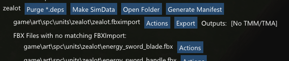

Hit the export button and if successful, it will show a `Load Model` button. There will also be a status message at the top of the window, like:
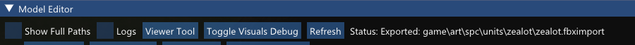

If conversion fails, it should say so here. You can also tick the `Logs` box to see the more detailed log output for more information. Looking at the entire log can be a bit daunting, but when a conversion fails there is almost always some very useful information there. So if model conversion fails and you don't know why, step 1 should always be to check the logs! Note that if the game crashes, you can find the log file at `C:\Users\<user>\Games\Age of Mythology Retold\temp\Logs\MythLog.txt` (the `temp` directory is next to the `76561198045783412` directory that contains the `mods` directory).

If you use the `Load Model` button right now, the menu should change
You can now use the `Load Model` button to load the model into the game. If it succeeds, there will now be `Hot Relead Model` and `Show Model` buttons as well. Note that the model is only loaded until the next game restart, until it is added to the manifest file using the `Generate Manifest` button. The `modelManifest_mods.xml` file is a generated file that tells the game what custom models to load - if your custom model entry is not in here, it cannot load. Changing this file requires a game restart. Make sure to click `Generate Manifest` every time after adding a new model.

The `Show Model` button shows this:
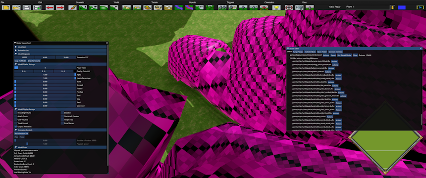

Maybe a little bit too big. Lets change the scale in `"adjustment_transform"` in the fbx import to 0.01. Save the .fbximport, click `Export` again and then click `Hot Reload`. 

Much more reasonable now. Now check the size against an actual unit. Elites are actually much taller than humans, so lets place Ajax down next to it and compare. Ajax is pretty tall and is almost the same height, so we need to increase the scale a bit. Lets try 0.0105. `Export` > `Hot Reload`, looks much better now.

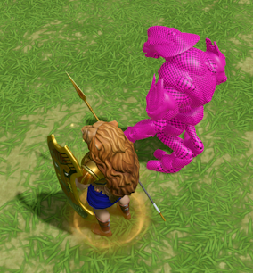

As mentioned earlier, it is probably best to scale your model to the game's scale. Now that I know that my model is about `100x` larger than it should be, I can go back to blender and scale it down `100x`, re-export it, change the .fbximport `"adjustment_transform"` to `1.05`, and re-convert it.

## Animations
Next lets look at the process for importing animations. It's almost identical to the process for importing models:
1. Create animation fbx file - generally this is just an armature with keyframes for a single animation
2. Create fbximport file - set the "skeleton" field to the path of the model the animation is for
3. Use in-game menu to convert model
4. Use in-game menu to generate manifest file
5. Repeat 1-4 for any other animations 
6. Restart game

It is ***highly recommended*** to export your animations at the same scale as the model that will be using them. Though technically it is possible to export the model at `0.01x` scale and the animations at `1x` scale, sometimes you can run into issues such as the model disappearing when the camera is too close to the model in-game.

After converting animations, they can now be used the same way any animation is in anim xml files.

At this point, we have enough assets to create a unit: simply create an `anim.xml` file for the unit, add a matching protounit to `proto_mods.xml` referencing the anim file, `generate simdata` for the model and add the relevant entries to `simdata_mods.xml`. This part is exactly the same as standard unit/model modding. For the purposes of this walkthrough, I just went ahead and copied the animfile and protounit for the Toxotes, and replaced the relevant animation paths and values, just so to get a unit in-game to test. Heres how it looks in-game - note we haven't set the materials up yet:


### Further note on simdata:
`simdata_mods.xml` is another **mandatory** file containing data required for visuals, animations and sounds to work correctly. Basically **any** change to an anim xml file, model, animation or fbximport file **requires** updating the simdata for **all relevant units**. 
The easiest way to handle simdata when using custom models is to use the `Generate Simdata` button in the in-editor Model Convert Tool for your mod's entry. This will create a `simdata_generated.xml` file in your mod's local directory. Open it, find the `<visual>` and `<animxml>` entries relevant to any **units OR visuals** you have added, and copy them to your `simdata_mods.xml`. Every unit should have both a `<visual>` and `<animxml>` entry (one entry may be at the very bottom of the file). Without both entries, the unit wont show up in the game - if you have validation enabled in your user config, the game should show errors on startup about this. This is all you really *need* to know about simdata to be able to get custom models into the game - the AoMR modding channel on the official Age of Empires discord server is the place to ask if you need help or more information on this.


## Materials
### Material Basics
Models in this game typically have 4 textures:
* `BaseColor` - RGBA texture that contains the diffuse colour in RGB (and optionally the transparency in A). Should be an sRGB texture.
* `Normals` - standard DirectX format normal map.
* `Masks` - ORM (Occlusion, Roughness, Metallic) texture that contains 3 masks: *Occlusion* in R, *Roughness* in G, *Metallic* in B. *Occlusion* is effectively a "detail" mask: fake shadows that are rendered onto the base colour to give the illusion of more detail. *Roughness* is literally how rough the texture is. And *Metallic* is literally how "metallic" the texture is.
* `Masks2` - typically a single-channel texture that contains the mask for Player Colour. This mask determines what parts of the `BaseColor` texture get "re-coloured" with the player's colour, and the strength of the "re-colouring" is determined by the pixel values in the mask texture (black is `0%`, white is `100%`).

Note that you should ***never*** use `.png` files as textures for models as they cause stutters when loading the model. For best results you should use `.ddt` (converted with Crybar) or `.dds`. While you can use other formats such as `.tga`, you may find they look washed out.

### Material Setup
Now to set up the materials. For this model, we have three standard lit materlals and two emissive materials. Only the emissive materials have transparency, and we only want to apply player colour to the emissive materials.

First materials are simple, just add 3 standard `opaque_lit` materials referencing our textures. Example:
```
<submaterial name="Zealot_Armor">
  <materialdef name="opaque_lit"></materialdef>
  <parameters>
    <texture name="BaseColor" override="spc\units\zealot\textures\elite_armor_diffuse_atlas"></texture>
    <texture name="Normals" override="spc\units\zealot\textures\elite_armor_normal_atlas"></texture>
    <texture name="Masks" override="spc\units\zealot\textures\elite_armor_ORM_atlas"></texture>
  </parameters>
</submaterial>
```

The emissive materials are more interesting. Both materials have the same parameters, so here is an example:
```
<submaterial name="Elite_GlowStrips">
		<materialdef name="opaque_lit_doublesided"></materialdef>
		<parameters>
			<texture name="BaseColor" override="spc\units\zealot\textures\elite_general_stripes_illum_alpha"></texture>
			<texture name="Normals" override="spc\units\zealot\textures\generic_normal"></texture>
			<texture name="Masks" override="spc\units\zealot\textures\generic_masks"></texture>
			<texture name="Masks2" override="spc\units\zealot\textures\elite_general_stripes_illum"></texture>
			<texture name="Emissive Texture" override="spc\units\zealot\textures\elite_general_stripes_illum"></texture>
			<texture name="Emissive Crawling Texture" override="spc\units\zealot\textures\emissive_crawl_white"></texture>
			<float name="Alpha Cutout Threshold" override="0.0100"></float>
			<float name="Emissive Crawling Speed" override="0.0"></float>
			<float name="Emissive Intensity" override="30.0"></float>
			<float name="Emissive Crawling UV Scale" override="1.0090"></float>
			<float name="Player Color Threshold" override="0.1000"></float>
		</parameters>
		<permutations variant="0">
			<permutation>ALPHA_CUT_OUT</permutation>
			<permutation>EMISSIVE</permutation>
		</permutations>
	</submaterial>
```
Note that we pass the emission texture to `Masks2` as well, so that the emission texture gets coloured by player colour.

To get the effect we want, there are a couple of important points:
* For `BaseColour` we want a transparent texture, so we take our emission texture and make it transparent (just put the Red channel as the Alpha channel) so that we can make use of `Alpha Cutout` to get transparency.
* This is a transparent purely emissive material (in blender) - there is no normal map or ORM masks.  We just pass in generic 0 strength normal maps and ORM masks.
* We pass the emission texture to `Masks2` so that the emission texture gets coloured by player colour.
* Obviously, we set the `Emissive Texture` to the emission texture. The `Emissive Crawling Texture` is also required in order for an emissive material to work. Its just a texture that can be scrolled that gets masked by the `Emissive Texture`. We dont care for animated glows, so we just make it a pure white texture. This texture (may) also be affected by player colour.
* `Alpha Cutout Threshold` defines the alpha value that should be transparent in the `BaseColour` texture. Alpha values below this threshold are rendered as fully transparent, otherwise are rendered fully opaque.
* `Emissive Crawling Speed` and `Emissive Crawling UV Scale` are unused, so we set the crawl speed to 0 and scale to 1.
* `Emissive Intensity` defines how bright the glow is.
* `Player Color Threshold` seems to be the threshold to apply player colour for the emissive texture.

Example of an emission texture:

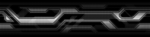

Aside from adding permutations, it looks like (most) material changes do not require game restarts, only need to hot reload the model. However, if you aren't seeing changes you are expecting, just restart the game!
Heres what the model now looks like with the material, in both red and blue player colour.


Note that the colours look very washed out compared to what it looked like in blender - this is expected because we are still using the source .tga textures and havent converted them to DDT. So lets do that next.

Using CryBar Editor, we just use the "Image to DDT" option in the Convert menu. To find out what the correct conversion settings are, we can just go find an in-game texture of the same type (diffuse, masks, normal, emission etc) and copy those settings. For this example, I went and copied the settings from a texture with alpha: `game\art\norse\units\myth\valkyrie\textures\valkyrie_horse_mata_BaseColor.ddt` (displayed in yellow on the top right) - RTS4, 9 Mips, Usage: 0, Format: 9, Alpha: 4. Convert all diffuse textures with these settings, all normals with the settings used by `valkyrie_horse_mata_Normals.ddt`, masks by `valkyrie_horse_mata_Masks.ddt` etc.

Heres the result:


Note: you can also convert textures to DDS format (DXT5, sRGB for colour textures) which works the same as DDT, with the added bonus that DDS textures can be opened and edited in most image editing software.

If you find your textures look incredibly low resolution after conversion, consider reducing the number of generated mips. In this case, it looks perfectly fine, so no need to change anything.


Heres how it looks with the idle animation:<br>


## Setup Attach Points
At this point we have a simple unit setup with basic animations. The next step is to setup the attach points for the model so that we can attach a weapon, vfx, whatever. 

Revisiting the `zealot.fbximport` file we created earlier, lets have a look at the `"attachments"` section. This is the section that defines the "interface" between the game and the model data, and is how we expose specific bones or transforms as "attach points". Lets start off simple: we want the unit to be able to equip a weapon in it's right hand. To do this, we define an attachment based off of the *bone* the model's skeleton uses for their right hand. Here is the entry we start with:
```
"attachments": [
  {
      "dummy": "weapon_r",
      "bone": "b_r_grip",
      "preview": "",
      "transform": {
          "t": [0.0, 0.0, 0.0],
          "r": [0.0, 0.0, 0.0],
          "s": [1.0, 1.0, 1.0]
      },
      "DummyBoneMode": "AddToSim",
      "DummyBoneTransformMode": "AllFrames"
  }
```
Going over this snippet, the three important fields are:
- `"dummy"`: the name of the attach point we are exposing, in this case called "weapon_r". This is the name for use in anim xml files, for attaching either objects or vfx.
- `"bone"`: the actual bone this attach point is attached to.
- `"transform"`: transform of the attach point **relative** to the bone. Seems to be applied in the order of translation, rotation, scale.

These three fields are the minimum requirements to expose an attach point. As for the rest of the fields:
- `"preview"`: probably used with dev tools, can leave blank.
- `"DummyBoneMode": "AddToSim"`: forces this bone/attach point to be added to the sim
- `"DummyBoneTransformMode": "AllFrames"`: ensures that the attach point stays "attached" to the bone while animating - in some cases, this parameter is required as the attach point gets locked to the location the bone was in the first frame of the animation.

Note that these fields are not always required for attach points. If you encounter issues, check the TMM model documentation pdf for if your issue is mentioned specifically there.

Next we need to add the `LaunchPoint` entry because we want this unit to be able to shoot. There are a few ways to do this:
- the first is just set the `LaunchPoint` as a static location (eg, somewhere in front of the unit)
- the second is to just set the `LaunchPoint` to a specific bone. This works sometimes, but sometimes this will also introduce a random offset from the bone to the actual `LaunchPoint`
- the third is to add an "Empty" to the actual model itself, parenting it off of a bone, then use the "Empty" as the bone for the `LaunchPoint`. For the most part this works very well, and I only rarely see the issue where the actual `LaunchPoint` is offset from the bone.

I will opt for option three here, so heres what the model now looks like with 2 "Empties" attached to each hand:


Here is the relevant fbximport attachment entry:
```
{
    "dummy": "LaunchPoint",
    "bone": "LaunchPoint",
    "preview": "",
    "transform": {
        "t": [0.0, 0.0, 0.0],
        "r": [0.0, 0.0, 0.0],
        "s": [1.0, 1.0, 1.0]
    },
    "ForcedDummyBoneName": "LaunchPoint"
}
```
Re-import the model, hot-reload, generate simdata and close the game. I went and added the weapon attachment to the anim file, so when we restart the game, if everything worked, the unit should be holding a weapon. Lets load the game up, place the unit and have it shoot something, and see how it goes:


So our weapon attachment worked, but for some reason the projectile is coming from the floor.<br>
**Note:** this is because I am using `<flag>DirectProjectile</flag>` to force this units projectiles to shoot in a straight line. Without that tag, the arrows do actually shoot from the correct location. But for some reason, the `DirectProjectile` tag adds an offset to the launch point of projectiles for the unit - so we just need to compensate for it!

To fix this, we try to adjust the location of the launch point in the fbximport: lets see what happens when we set the translation to 2m up:
```
"transform": {
    "t": [0.0, 2.0, 0.0],
    "r": [0.0, 0.0, 0.0],
    "s": [1.0, 1.0, 1.0]
  },
```
Re-import model, hot reload, generate simdata, restart the game. Trying the same test again, and now the arrow is too high. Lets set the vertical offset to `1.6`, repeat the process again, and:


Its now shooting from the correct location.

### Why the heck does this happen?
Honestly I dont actually know the cause of this: for some models, the launch point works perfectly fine when directly attached to bones. For other models, using an "Empty" attached to a bone works perfectly fine. For some models, the "Empty" trick only works if the model is similarly scaled to other in-game assets (eg, its scaled down to `0.01x` on export from blender and the FBXImport scale is `1.0`). It may also depend on the projectile itself, whether the projectile is a standard projectile, `DirectProjectile`, or a beam. The visuals of the projectile itself may also affect this: if the vfx of a projectile is not directly centered on the projectile, it may look offset despite actually being correct. Likewise, the velocity of the projectile can also affect this: a very fast projectile may appear to spawn further away than it's actual spawn location. 

Debugging this can be a massive pain, as if you do encounter a misalignment issue like this, for every change and tweak you make, you *have* to re-import models, hot-reload models, generate simdata AND restart the game. The best advice I can give here is to take a systematic approach: change one thing at a time, dial in one axis at a time, and understand what the change you just made actually did. 

If you find that no matter what you do, you cant get a bone attached launch point to line up right, just use a static launch point (leave the bone field empty).

### Notes on editing attach points
For attach points that aren't `LaunchPoints` (eg, just for attaching models or VFX), you can easily test and tweak their transforms without restarting the game, by using the hot-reload model functionality. Simply display the model using the in-editor Model Viewer Tool, edit your fbximport, re-convert the model, click hot reload, and the changes should appear instantly on the Model Viewer model. The model viewer also has visualisers for attach points, so you can see exactly what editing the transform of the attach point actually does in-game. Note that in some cases you will still need to do the whole genereate simdata + restart process for all the changes to flow through (eg, if the attach point is a launch point)


So at this point, we have covered everything that is required to get a custom model into the game, give it animations, and give it a launch point.


## PopcornFX
It is also possible to add custom VFX for our unit using PopcornFX. This section will provide a very brief overview of how to set up the editor, bake effects and how to use them in a mod.

First, the official youtube series is recommended to get a good grasp of the fundamentals: https://www.popcornfx.com/tutorials/

Secondly, the full source PopcornFX project used for this mod can be found in `tutorial_resources/popcornfx_project`. Effects can all be found in the `Particles` folder, and assets can be found in `Content`. There are some comments trying to explain things inside each of the effects - however, make sure to at least have a baseline understanding of how to use PopcornFX first before having a look otherwise nothing will make sense.

### Setup
The `Popcorn_VFX_Documentation.pdf` file is the official documentation for this, but the only actually useful information we take from it is:
* PopcornFX version: `2.19.6.21657` - you must use this exact version (as of writing)
* `-x=lhyup` - this means they are using Left Handed Y Up for their coordinate frame
* `PopcornMetaData.xml` - you must add relevant entries to this file (which can be done additively via `PopcornMetaDataMods.xml`)

<br>

As for setting up the actual PopcornFX project: install PopcornFX version `2.19.6.21657` and create a new project. There are now a few things to setup to configure things correctly:
#### Coordinate Frame
In `Project Settings`, navigate to `Scene`, and set `Coordinate Frame` to `Left_Handed_Y_Up`. If you do not set this correctly some particle directions may be inverted when imported in game.


#### Baking Config
Still in `Project Settings`, navigate to `Baking`. There are two fields here: `Platform Settings List` and `Build Versions`. `Platform Settings List` effectively defines the output directory when you bake in this project. `Build Versions` is a completely arbitrary "tag" for setting up different build configurations (eg. you could add an "Mobile" tag and set up your build to only use low-resolution assets.).
   * `Platform Settings List`: The format is `<some text>:/<some path>` (eg. `x64:/Path/To/Bake/Output`). For our purposes, the text at the front (the `x64`) doesn't matter, but the `path` does matter: this is where your baked assets get output to. 
   * `Build Versions`: put whatever you want, I just use `2_19`

Remember to use the little `+` button on the right to actually add your entry!


#### Asset Layout
I'm not 100% sure if this section is required, however this is how the assets in the game are set out, so it is probably best to use the same structure.

* In the `Asset Treeview`, create a `Content` folder at the top level. This is where you should put all of your custom assets (textures, meshes etc.). 


* Also create a `Particles` folder at the top level. This is where you should put all of your custom VFX assets (pkfx etc).

#### Baking
Once you have some VFX assets to bake, right click the asset(s) and select `Bake`. A window will pop up displaying progress and successes/failures. Once the baking is complete, head over to the directory you specified in the `Platform Settings List` in your `Project Settings`. If you set it up the same way I did, you should see 3 folders: `"Content"`, `"Library"` and `"Particles"`.

#### Mod Setup
To actually use custom popcorns in your mod, first you need to setup the directory. Popcornfx assets need to live in `<modname>/game/art/vfx/popcornfx`, so create that directory. Next, copy the three folders from the bake output into the `popcornfx` directory in your mod. This directory setup exactly mirrors where the game's popcornfx assets can be found, so if you are unsure, take a look using Crybar. 

Inside the `popcornfx` directory, next create `popcornmetadatamods.xml`. The outer tag should be `</pkmetamods>`. You will need to add an entry here for each custom particle effect you added (every .pkfx file). If you structured your popcornfx project the same way I did, all your particle files should be in /Particles. Add an entry for each file like so:
```
<pkmetamods>
    <pkfx filename="path\relative\to\popcornfx\folder" type="alwayssimulate\healthfire\onlywhenvisible"></pkfx>
    <pkfx filename="particles\MyAwesomeFireball.pkfx" type="onlywhenvisible"></pkfx>
</pkmetamods>
```

The filename path here is relative to the popcornfx folder mentioned earlier. So if all your pkfx files are in the Particles folder, all your filename paths should look like `"particles\effect_name_here.pkfx"`. Regarding `"type"`, there are 3 options: <br>
* `alwayssimulate` means the particle always renders regardless of visiblity (ie. it renders even when offscreen)<br>
* `onlywhenvisible` means the particle only renders when on-screen. This means that it will stop rendering when it leaves the view, and start rendering again when entering the view.<br>
* `healthfire` is related to building damage I think.<br>

As an example, here is the `popcornmetadatamods.xml` contents for this mod with all my custom effects in there.
```
<pkmetamods>
    <pkfx filename="particles\EnergySwordBlade.pkfx" type="onlywhenvisible"></pkfx>
    <pkfx filename="particles\EnergySwordFlash.pkfx" type="onlywhenvisible"></pkfx>
    <pkfx filename="particles\EnergySwordSlash.pkfx" type="onlywhenvisible"></pkfx>
    <pkfx filename="particles\EnergySwordBladeOneSecond.pkfx" type="onlywhenvisible"></pkfx>
    <pkfx filename="particles\PlasmaGrenadeExplosion.pkfx" type="onlywhenvisible"></pkfx>
    <pkfx filename="particles\PlasmaGrenadeSelfDestruct.pkfx" type="onlywhenvisible"></pkfx>
    <pkfx filename="particles\PlasmaGrenadeFlame.pkfx" type="onlywhenvisible"></pkfx>
    <pkfx filename="particles\PlasmaRifleBeamVersion.pkfx" type="onlywhenvisible"></pkfx>
    <pkfx filename="particles\PlasmaRifleGlow.pkfx" type="onlywhenvisible"></pkfx>
    <pkfx filename="particles\PlasmaRifleMuzzleFlash.pkfx" type="onlywhenvisible"></pkfx>
    <pkfx filename="particles\PlasmaRifleProjectile.pkfx" type="onlywhenvisible"></pkfx>
</pkmetamods>
```
Once you have added your custom pkfx file entries, you can use them exactly the same as any other pkfx file in the game - except that the file path you reference them with is now relative to the `particles` directory. For example, if I want to use `PlasmaGrenadeExplosion.pkfx` as a popcornfx in an anim file, the correct usage would be `<file>PlasmaGrenadeExplosion.pkfx</file>`.

Another thing to note: make sure to have `stopwithanim="true"` for particles that have `infinite life`, or your game will eventually crash!

### PopcornFX notes
* The default scene scale in PopcornFX is the same as in-game.

* Do **not** use `.png` files for your textures (due to the hitching issue): use `.tga` or `.dds`.

There are a some "quirks" with popcornFX to watch out for. 
* Not every feature available in the editor is actually implemented in-game. A good example of this are ribbon particles: if you try to use the `Atlas` feature with the `CustomU` feature to create an animated ribbon, it will look immensely scuffed in-game (this may be why the Onmyoji fireball trail looks kinda strange).

* `effect.axisForward` is the forward direction the game passes to the effect. Use for effects that need to face a direction, eg to get an arrow projectile mesh to face the direction it flies in.

* Remember to use `local position to world` nodes for position, otherwise the effect is rendered relative to the south corner of the map under the floor. If an effect is not rendering, check there first!

* For effects that need to have dynamic positions/rotations (eg, a projectile like a fireball), you must set the `Exec Stage` of physics related nodes to `Evolve`, otherwise they will default to `Spawn` and the effect will not move after spawning (or until a new particle spawns).
    * Includes but not necessarily limited to: `effect.axisForward` and friends, `local position to world`, `local direction to world`, `Physics`, as well as `Layers` in the case of rotations
    * The symptom of this issue are that particles do no move from their spawn location. For example, say you have a fire VFX that is meant to be a ground placed unit, with flame particles that have a lifetime of 1 second. If you place the VFX in the editor and drag it around, and the particles only spawn from the unit location every one second but *do not get dragged around*, it means there is a physics input that isnt set to `Evolve`. For projectiles, this will often manifest as the particles not moving from the launch point until the projectile dies.

* Conversely, for effects that you want to _stay_ at their spawned location (eg. smoke trail, sparkles, onmyoji fire hands vfx etc), you can leave these nodes as `auto` or `Spawn` for `Execution Stage`

### Example popcornfx project contents
Here are previews of some of the effects in the project:

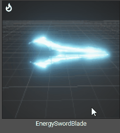 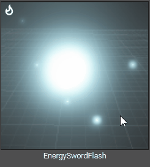 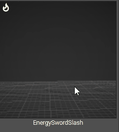

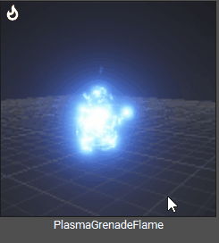 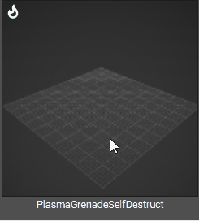 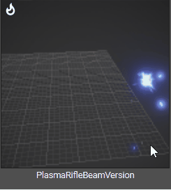

## Misc notes
* double check the material name(s) of exported models, especially if exported from blender
* game cannot load 4k textures, runs out of memory
* there is a limit to the number of bones a model can have (~200). doesnt error out, just doesnt import bones after a certain count (not verified on latest patch)
* model conversion only loads bones from the first "root" - if you have multiple top level bones in an armature, only the first one and it's children will be converted. The rest will be ignored: see in the image how the actual skeleton (red arrow) bone parent is at the bottom, so it gets ignored
  * 
* mips seem to make some textures look awful - this is especially bad for some textures when used in custom popcornFX
* most VFX **cannot** be scaled, but _some_ (like hero glow) can be scaled to a limited degree
* popcornfx: ribbon renderer with custom U and atlas+flipbook isnt supported, doesnt render correctly
* custom model units that share the same _skeleton_ can share simdata entries ie. it is possible to have one "master" unit that has every single custom animation associated with it in the anim file, and for every other unit to not need a `<visual>` section in simdata mods. while convenient, it is possible to unintentionally get into situations where changes to animations are not visible because of this
* icons use alpha for player colour mixing, where 0 alpha = maximum power of player colour
* alpha cutout seems to be the only transparency option for units
* emission requires an emissive crawl texture to function